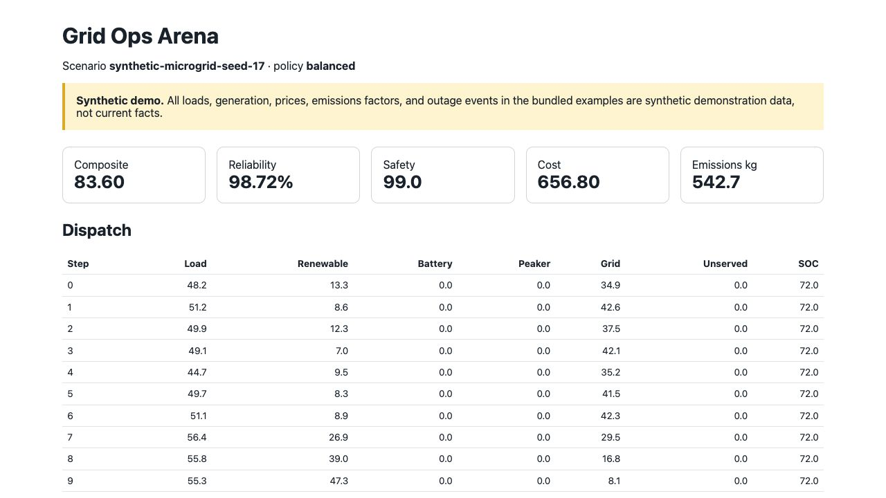

# Grid Ops Arena: make energy-policy tradeoffs visible

**Energy decision systems · Python · Educational simulator**

Independent project by **Nripanka Das**, developed with AI assistance.

[Live report](https://nripankadas07.github.io/grid-ops-arena/) ·
[Repository and quickstart](https://github.com/nripankadas07/grid-ops-arena) ·
[Back to profile](../../README.md)

*Screenshot of the synthetic seed-17 scenario, captured on 11 October 2026.*

## The product question

How can a reviewer compare a dispatch policy when lower cost may conceal unmet
demand or physically impossible requests? A useful evaluation needs a common
scenario, equipment constraints, and the evidence behind each score.

Grid Ops Arena is designed for developers and reviewers testing dispatch
software under controlled outages. Every bundled input is synthetic: load,
renewable generation, prices, emissions factors, and equipment events. Its
purpose is to inspect software behavior, not operate a grid.

## What was built

A versioned scenario feeds observations to a policy. The policy requests battery
and peaker actions; the simulator applies equipment limits and records both
requested and feasible actions. A step trace and JSON/HTML reports expose
reliability, cost, emissions, and safety from the same run.

Three design choices support fair review:

- **Replay the same workload.** Seeded scenarios and three inspectable baseline
  policies make comparisons reproducible within the simplified model.
- **Keep infeasible requests visible.** Clamping an action does not erase its
  constraint violation from the evaluation.
- **Expose component metrics.** Unserved energy and constraint violations remain
  visible alongside the composite score, preventing one number from concealing
  the policy's weaknesses.

## Demonstrated result

The saved `balanced` policy report uses seed 17 and 48 hourly steps:

| Measure | Synthetic fixture result |
|---|---:|
| Demand served | 98.72% |
| Unserved energy | 34.49 kWh |
| Constraint violations | 2 |
| Modelled emissions | 542.68 kg |
| Composite score | 83.60 / 100 |

These values describe one demonstration run. The useful outcome is that a
reviewer can trace the unmet demand and violations instead of accepting a
headline score. No real-world cost saving or emissions reduction is claimed.

[Exact report at reviewed commit](https://github.com/nripankadas07/grid-ops-arena/blob/2c5e25753b8e889bf28b99dba47f21e7d12e7b84/artifacts/demo/grid_ops_report.json) ·
[Simulator architecture](https://github.com/nripankadas07/grid-ops-arena/blob/2c5e25753b8e889bf28b99dba47f21e7d12e7b84/docs/architecture.md)

## Tradeoffs and next validation

The model uses hourly, single-bus energy balance. It omits network power flow,
voltage/frequency behavior, battery degradation, and many operating constraints.
Baseline policies are heuristics; the composite weights are illustrative.
These choices keep the prototype understandable but limit its applicability.

The next useful evaluation is a documented comparison of policies against
independent scenarios, followed by domain review of which omitted constraints
matter most. Real equipment use requires a different validation standard.

Evidence and live screenshot reviewed on **11 October 2026**.
[Full limitations](https://github.com/nripankadas07/grid-ops-arena/blob/2c5e25753b8e889bf28b99dba47f21e7d12e7b84/docs/limitations.md) ·
[AI-assistance disclosure](https://github.com/nripankadas07/grid-ops-arena/blob/2c5e25753b8e889bf28b99dba47f21e7d12e7b84/AI_ASSISTED.md).
