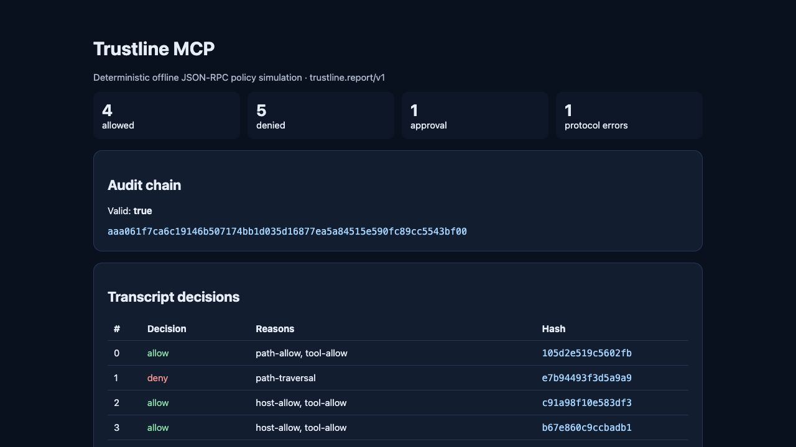

# Trustline MCP: inspect agent policy before connecting real tools

**Agent infrastructure · TypeScript · Experimental policy lab**

Independent project by **Nripanka Das**, developed with AI assistance.

[Live report](https://nripankadas07.github.io/trustline-mcp/) ·
[Repository and quickstart](https://github.com/nripankadas07/trustline-mcp) ·
[Back to profile](../../README.md)

*Screenshot of the synthetic attack fixture, captured on 11 October 2026.*

## The product question

An agent builder needs to explain more than whether a tool call succeeded:
which policy allowed it, what should trigger human review, and what evidence
remains afterward? A useful prototype makes those decisions inspectable before
introducing real execution and identity infrastructure.

Trustline addresses this as an offline policy lab. Its scope is a controlled
transcript of tool requests, not a deployed enforcement gateway. The intended
audience is builders and reviewers evaluating policy behavior.

## What was built

A deterministic pipeline validates each request, collects matching rules,
resolves a decision, simulates a fixture response, redacts sensitive fields,
and emits JSON plus a readable report. Local stdio and loopback HTTP transports
let MCP clients invoke the simulator and audit verifier.

Three design choices make the result reviewable:

- **Deny overrides allow.** Every matching rule is evaluated, so a later deny
  or stricter overlapping quota cannot disappear behind an earlier allow.
- **Approval is a visible state.** Missing review becomes an explicit result
  rather than an implicit successful action.
- **Audit records commit to policy and history.** Canonical payloads, the
  declared policy digest, and chained SHA-256 hashes support verification.
  Redaction happens before request/response fields are hashed.

## Demonstrated result

The checked-in synthetic attack fixture produces:

| Result | Entries |
|---|---:|
| Allowed | 4 |
| Denied, including default denial | 5 |
| Approval required | 1 |
| Protocol error | 1 |
| Total | 11 |

The audit verifier returns `valid: true`. The trace exposes path traversal,
blocked hosts, quota exhaustion, and denied arguments with reasons attached.
The product result is an inspectable decision record that another reviewer can
check. It is not evidence of reduced production incidents.

[Exact report at reviewed commit](https://github.com/nripankadas07/trustline-mcp/blob/12772ede5dee3c4c6f1d5b229ba427b79e9f890f/artifacts/demo/report.json) ·
[Policy architecture and boundaries](https://github.com/nripankadas07/trustline-mcp/blob/12772ede5dee3c4c6f1d5b229ba427b79e9f890f/docs/ARCHITECTURE.md)

## Tradeoffs and next validation

The lab does not execute upstream tools, authenticate reviewer identity,
provide sandbox isolation, or enforce durable quotas across processes. Its
unsigned audit proves self-consistency; an attacker replacing and rehashing the
whole bundle is outside that guarantee. Keeping these boundaries explicit
prevents a simulation result being mistaken for production authorization.

The next useful product validation is whether independent builders can use the
trace to find policy mistakes in their own representative transcripts. No such
adoption or usability result is claimed here.

Evidence and live screenshot reviewed on **11 October 2026**. AI assistance in
implementation, fixtures, tests, and documentation is
[disclosed by the project](https://github.com/nripankadas07/trustline-mcp/blob/12772ede5dee3c4c6f1d5b229ba427b79e9f890f/AI_ASSISTED.md).
