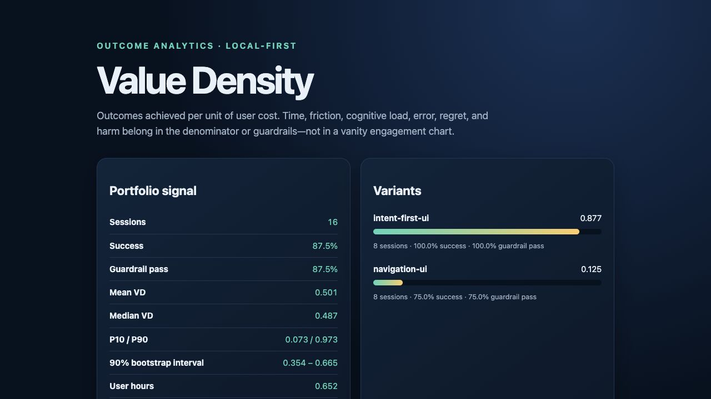

# Value Density Lab: measure completed outcomes against user cost

**Product measurement · TypeScript · Research reference implementation**

Framework and independent project by **Nripanka Das**, developed with AI assistance.

[Live report](https://nripankadas07.github.io/value-density-lab/) ·
[Repository and quickstart](https://github.com/nripankadas07/value-density-lab) ·
[Back to profile](../../README.md)

*Screenshot of the synthetic invoice fixture, captured on 11 October 2026.*

## The product question

More time in a product may mean deeper value, or it may mean the user is stuck.
How should a product team compare workflows while accounting for completed
outcomes, effort, regret, and harm?

Value Density Lab translates
[Nripanka Das's published Value Density framework](https://www.linkedin.com/pulse/beyond-attention-economy-value-density-framework-digital-das-5wiqc)
into an executable reference. The intended users are product and analytics teams
defining their measurement model. The project makes assumptions inspectable.

## What was built

A local session-event ledger feeds schema validation, archetype-specific scoring,
variant aggregation, and deterministic bootstrap intervals. The engine writes
versioned JSON, Markdown, and standalone HTML without an analytics service or
silent telemetry.

Three design choices keep the measurement open to challenge:

- **Define intent and outcome quality explicitly.** They are input contracts,
  not inferred truths extracted from click counts.
- **Keep regret and harm in view.** A faster flow cannot hide a failed outcome
  or a guardrail failure behind time saved.
- **Publish components and uncertainty.** Reviewers can inspect cohort sizes,
  completion, cost, weights, and interval estimates alongside the score.

## Demonstrated result

The deterministic invoice fixture contains 16 synthetic sessions, eight per
variant:

| Measure | Navigation flow | Intent-first flow |
|---|---:|---:|
| Sessions | 8 | 8 |
| Completion rate | 75% | 100% |
| Guardrail pass rate | 75% | 100% |
| Mean Value Density | 0.125 | 0.877 |

The result demonstrates that the engine can report the supplied outcomes and
costs together. The dataset was constructed to exercise the method; it is not
a real experiment and proves no causal improvement from interface design.
The scores apply only to the fixture's chosen definitions and weights.

[Exact analysis at reviewed commit](https://github.com/nripankadas07/value-density-lab/blob/6fff70e009115860d9b13429bbcab3b5d6359422/artifacts/demo/analysis.json) ·
[Measurement model and collection rules](https://github.com/nripankadas07/value-density-lab/blob/6fff70e009115860d9b13429bbcab3b5d6359422/docs/measurement.md)

## Tradeoffs and next validation

Intent, quality, friction, cognitive load, and regret need defensible operational
definitions. Scores across unrelated archetypes or collection methods are not
directly comparable. Bootstrap intervals do not remove confounding, selection
bias, or measurement error. Local processing also does not replace privacy
review of the collected events.

The next useful validation is a consented, prospectively defined product study
with independently measured outcome quality, qualitative feedback, and
pre-specified guardrails. No observed business lift is claimed before that work.

Evidence and live screenshot reviewed on **11 October 2026**.
[Full limitations](https://github.com/nripankadas07/value-density-lab/blob/6fff70e009115860d9b13429bbcab3b5d6359422/docs/limitations.md) ·
[AI-assistance disclosure](https://github.com/nripankadas07/value-density-lab/blob/6fff70e009115860d9b13429bbcab3b5d6359422/AI_ASSISTED.md).
